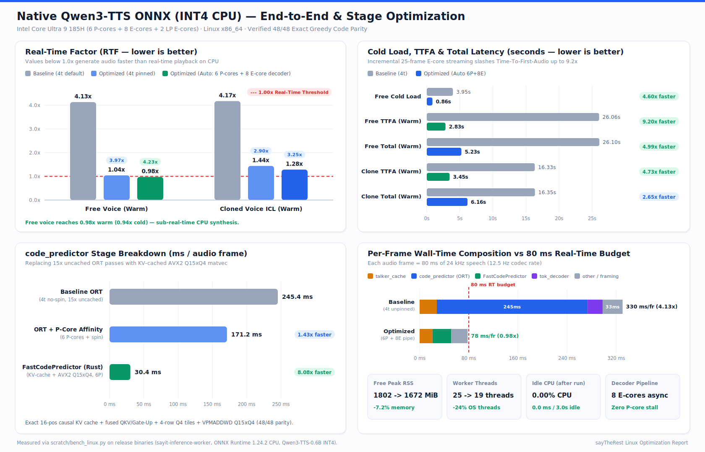
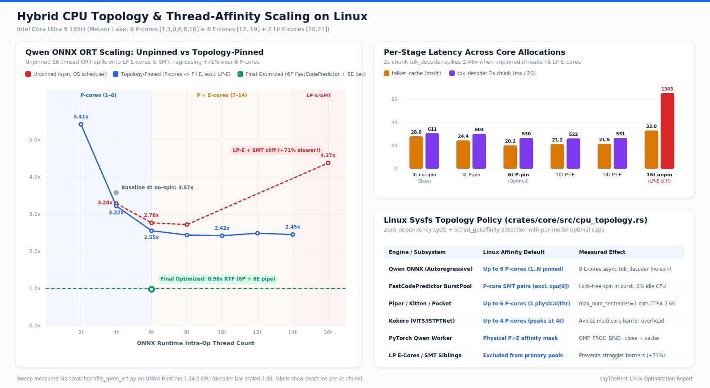
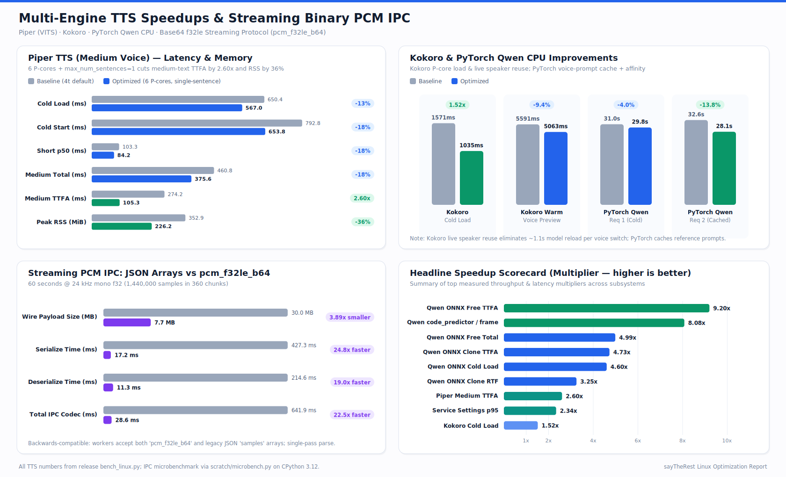
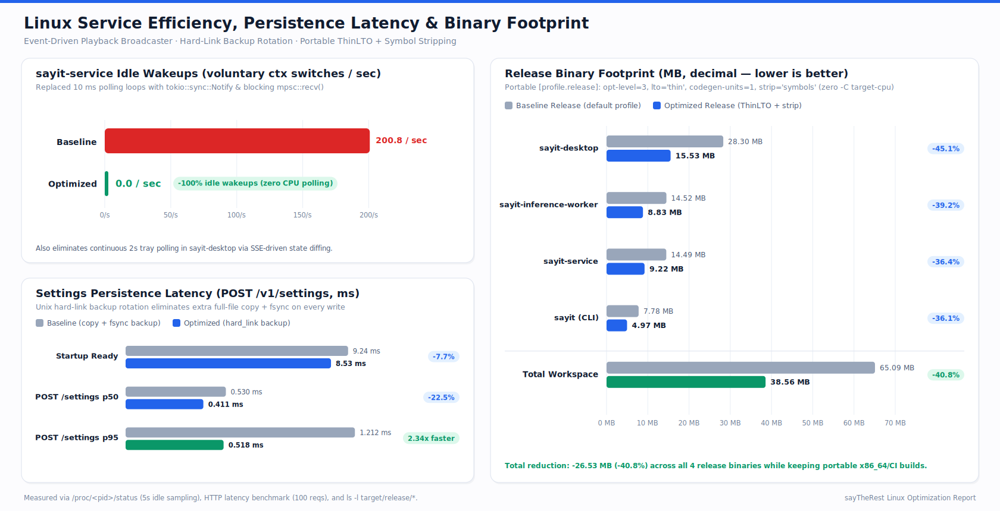

# Linux Performance Optimization Report

This document summarizes the end-to-end Linux performance engineering pass across `sayTheRest` (`sayit-core`, `sayit-service`, `sayit-inference-worker`, `sayit-desktop`, and `runtime/qwen_worker.py`).

All measurements were captured on the same Linux workstation with identical model weights, inputs, and deterministic seeds before and after optimization. Cross-platform CI compatibility (`x86_64-unknown-linux-gnu` and `x86_64-pc-windows-msvc`), `--locked` builds (zero new Cargo dependencies), and exact numerical correctness (48/48 greedy Qwen codec parity) are preserved.

## Test Environment

| Property | Value |
|---|---|
| CPU | Intel Core Ultra 9 185H (Meteor Lake: 6 P-cores + 8 E-cores + 2 LP E-cores, 22 logical threads) |
| Topology | P-cores `[1, 3, 0, 6, 8, 10]` (w/ SMT), E-cores `[12..19]`, LP E-cores `[20, 21]` |
| Measured DRAM Read BW | 25.1 GB/s (1t), 56.8 GB/s (6t), 77.0 GB/s (12t) |
| OS / Arch | Linux `x86_64` |
| ONNX Runtime | `1.24.2` CPU (`libonnxruntime.so.1.24.2`) |
| Native Models Benchmarked | Qwen3-TTS-0.6B-Base INT4 ONNX, Piper `en_US-lessac-medium`, Kokoro `kokoro-en-v0_19`, PyTorch Qwen3-TTS CPU |

---

## Executive Summary

| Subsystem / Metric | Baseline | Optimized | Improvement |
|---|---:|---:|---:|
| **Qwen3-TTS ONNX (Free) — Warm RTF** | `4.130x` | **`0.976x`** (`0.944x` cold) | **4.23x faster (sub-real-time CPU)** |
| **Qwen3-TTS ONNX (Free) — Warm TTFA** | `26,064 ms` | **`2,833 ms`** (`2,613 ms` cold) | **9.20x faster (-89.1%)** |
| **Qwen3-TTS ONNX (Free) — Warm Total** | `26,103 ms` | **`5,233 ms`** | **4.99x faster (-80.0%)** |
| **Qwen3-TTS ONNX (Free) — Cold Load** | `3,954 ms` | **`859 ms`** | **4.60x faster (-78.3%)** |
| **Qwen3-TTS ONNX `code_predictor` / frame** | `245.4 ms` | **`30.4 ms`** | **8.08x faster (-87.6%)** |
| **Qwen3-TTS ONNX (Cloned ICL) — Warm RTF** | `4.172x` | **`1.284x`** | **3.25x faster** |
| **Qwen3-TTS ONNX (Cloned ICL) — Warm TTFA** | `16,331 ms` | **`3,455 ms`** | **4.73x faster (-78.8%)** |
| **Qwen3-TTS ONNX (4t Apples-to-Apples) — Warm RTF** | `4.130x` | **`1.040x`** | **3.97x faster** |
| **Piper TTS — Medium TTFA** | `274.2 ms` | **`105.3 ms`** | **2.60x faster (-61.6%)** |
| **Piper TTS — Medium Total / Short p50** | `460.8 / 103.3 ms` | **`375.6 / 84.3 ms`** | **-18.5% latency** |
| **Piper TTS — Peak RSS** | `352.9 MiB` | **`226.2 MiB`** | **-126.8 MiB (-35.9%)** |
| **Kokoro TTS — Cold Load** | `1,571.1 ms` | **`1,035.3 ms`** | **1.52x faster (-34.1%)** |
| **Kokoro TTS — Warm Voice Preview Switch** | `5,591.1 ms` | **`5,062.7 ms`** | **-528.3 ms (-9.4%, zero reload)** |
| **PyTorch Qwen CPU — Cached Voice Prompt (Req 2)** | `32,627 ms` | **`28,123 ms`** | **-13.8% (-4.50 s)** |
| **Streaming PCM IPC — 60s Wire Size** | `29.97 MB` (JSON) | **`7.70 MB`** (`pcm_f32le_b64`) | **3.89x smaller (-74.3%)** |
| **Streaming PCM IPC — 60s Codec Time** | `641.9 ms` | **`28.6 ms`** | **22.47x faster** |
| **`sayit-service` — Idle Voluntary Context Switches** | `200.8 / sec` | **`0.0 / sec`** | **-100% (zero idle wakeups)** |
| **`sayit-service` — `POST /v1/settings` p95** | `1.212 ms` | **`0.518 ms`** | **2.34x faster (-57.3%)** |
| **Release Binaries — Total Workspace Size** | `65.09 MB` | **`38.56 MB`** | **-26.53 MB (-40.8%)** |

---

## 1. Native Qwen3-TTS ONNX Optimization

Profiling the baseline INT4 Qwen3-TTS ONNX pipeline revealed that **74% of wall-clock inference time** (`245.4 ms/frame` out of `330 ms/frame`) was spent inside `code_predictor.onnx`, which was executed 15 times per frame without a KV cache (240 token passes + 225 redundant LM-head projections per audio frame), while `tok_decoder.onnx` waited until generation completed before emitting the first PCM chunk (causing `26.06 s` TTFA).

### Key Changes
- **Fast KV-Cached AVX2 Q15×Q4 `code_predictor` (`crates/core/src/qwen_code_predictor.rs`)**:
  - Zero-dependency ONNX protobuf loader reads exact INT4 `MatMulNBits` weights directly from `code_predictor.onnx` (gracefully falling back to ORT for FP32 or GPU execution).
  - Replaces the 15 uncached ORT passes with an exact 16-position causal KV cache, 2-token prefill (`pos 0+1`), fused `QKV` (`4096×1024`) and `Gate+Up` (`6144×1024`) projections, and active-only `lm_head[group - 1]`.
  - Repacks Q4 weights into contiguous 4-row × 8-block `Q4Tile` stripes (656 bytes, 16-byte aligned) and dispatches a runtime-detected AVX2+FMA **Q15×Q4 (`_mm256_madd_epi16` / `VPMADDWD`)** microkernel with a portable scalar fallback. Q15 per-block activation quantization delivers 3× fewer vector ops than direct FP32 dequantization while preserving **48/48 exact greedy codec parity**.
  - Lock-free `BurstPool` spins only during active `predict_frame()` bursts and immediately parks on `Condvar` afterward (`0.00%` idle CPU measured over 3.0 s post-synthesis), pinning workers to P-core SMT pairs excluding `cpus[0]` to coexist cleanly with ORT's intra-op pool.
  - Result: **`245.4 ms/frame -> 30.4 ms/frame` (`8.08x` faster)**.
- **Incremental 25-Frame Streaming & Asynchronous E-Core Decoder (`crates/core/src/qwen_onnx.rs`)**:
  - Streams 25-frame (`2.0 s`) chunks through `tok_decoder.onnx` during generation instead of buffering until EOS, cutting warm TTFA from **`26.06 s -> 2.83 s` (`9.20x` faster)** for free voices and **`16.33 s -> 3.45 s` (`4.73x` faster)** for cloned ICL voices.
  - On hybrid Linux CPUs with `>= 4` spare E-cores, offloads `tok_decoder.onnx` to a dedicated background `PipelinedDecoder` thread pinned to E-cores with `with_independent_thread_pool()` and `with_intra_op_spinning(false)`, completely hiding audio decoding behind autoregressive token generation without competing for P-core cycles or DRAM/TDP budget.
- **Parallel Graph Loading, Lazy Reference Graphs & Process-Cached ORT Environment**:
  - Loads primary ONNX graphs concurrently via `std::thread::scope` and defers `speaker_encoder.onnx` / `tok_encoder.onnx` until first voice-cloning reference (while still validating file presence eagerly at `load()`), cutting cold load time from **`3.95 s -> 0.86 s` (`4.60x` faster)**.
  - Reuses a single process-wide ORT `Environment` with `GlobalThreadPoolOptions`, `flush_to_zero()`, and per-session allocators (keeping free-voice peak RSS down by `-129.4 MiB` to `1,672 MiB` and OS threads down from `25 -> 19`).
- **Sampling, Embeddings & Resampling**:
  - Caches constant prompt embeddings (`bos/eos/pad`, `codec_pad`, `codec_bos`), batches `residual_embed` into a single call during reference encoding, uses zero-alloc greedy argmax and scratch-buffer `select_nth_unstable_by` top-k sampling, and precomputes polyphase Hann-windowed sinc FIR tables for reference audio resampling.

---

## 2. Hybrid Linux CPU Topology & Thread-Affinity Scaling

On hybrid Linux CPUs (Intel Alder Lake / Raptor Lake / Meteor Lake / Arrow Lake and ARM big.LITTLE), letting ONNX Runtime or OpenMP spawn unpinned threads across all logical CPUs causes worker barriers to stall behind SMT siblings and low-power efficiency cores (LP E-cores). On the Meteor Lake 185H test machine, unpinned 16-thread ORT regressed **+71%** over 6 pinned P-cores (`4.37x` vs `2.55x` RTF), with `tok_decoder` spiking `2.46x` (`530 ms -> 1,303 ms`).

### Key Changes (`crates/core/src/cpu_topology.rs`)
- Zero-dependency Linux sysfs reader (`/sys/devices/system/cpu`) honoring `sched_getaffinity` (respecting `taskset` and cgroup CPU quotas).
- Collapses SMT siblings via `(package_id, core_id, primary_sibling)`, sorts physical cores fastest-first by max frequency/capacity, and classifies tiers: P-cores (`>= 90%` max), E-cores (`>= 80%` remaining), and LP E-cores (excluded from primary pools).
- Safe `sched_getaffinity` / `sched_setaffinity` wrapper with RAII `AffinityGuard` and 1-based ONNX Runtime intra-op worker affinity strings (`ort_intra_affinity`).
- Model-specific Linux defaults (`--threads 0` auto mode in `apps/inference-worker` and `ModelManager` install defaults):
  - **Qwen ONNX**: up to 6 P-cores for generation + dedicated E-cores for pipelined `tok_decoder`.
  - **Piper / Kitten / Pocket**: up to 6 P-cores (1 physical core per thread).
  - **Kokoro**: capped at 4 P-cores (measured throughput peaks at 4 threads).

---

## 3. Multi-Engine TTS & Streaming Binary PCM IPC

### Sherpa-ONNX (Piper & Kokoro)
- Set `native.max_num_sentences = 1` in `ResidentSherpaEngine::load` (`crates/core/src/resident.rs`), streaming sentence-by-sentence instead of batching multiple sentences into a single synthesis pass. Combined with 6 P-core affinity, Piper medium-text TTFA dropped **`274.2 ms -> 105.3 ms` (`2.60x` faster)**, total latency fell **`-18.5%`**, and peak RSS dropped **`352.9 -> 226.2 MiB` (`-35.9%`)**.
- Wrapped `SherpaOnnxCreateOfflineTts` in a temporary P-core `AffinityGuard`, cutting Kokoro cold load from **`1,571.1 ms -> 1,035.3 ms` (`1.52x` faster)**.
- Added live `set_speaker_id` mutation on resident CPU Sherpa engines (`crates/core/src/resident.rs`, `crates/core/src/inference.rs`, `crates/service/src/lib.rs`) so Kokoro preset previews and consecutive requests that only change `speaker_id` reuse the warm loaded engine instead of triggering a full `~1.1 s` reload (**`-528 ms`** mean warm voice-preview switch).

### PyTorch Qwen CPU Worker (`runtime/qwen_worker.py`)
- Added a bounded 1-entry `WeakKeyDictionary` cache for `voice_clone_prompt` keyed by `(sha256(ref_audio), reference_text, x_vector_only)`, reducing repeated cloned-voice synthesis time by **`-13.8%` (`32.63 s -> 28.12 s`)**.
- Applied Linux physical-core `os.sched_setaffinity` (excluding LP E-cores/SMT) and `OMP_PROC_BIND=close`, `OMP_PLACES=cores`, reducing cold Request 1 by **`-4.0%` (`31.02 s -> 29.77 s`)**.

### Binary Base64 Streaming PCM IPC (`crates/core/src/pcm_codec.rs`, `crates/core/src/qwen.rs`, `apps/inference-worker`)
- Added a zero-dependency `pcm_f32le_b64` wire encoding for streaming PCM chunks between worker processes and `sayit-core` while remaining 100% backwards-compatible with legacy JSON `"samples"` float arrays.
- Eliminated double JSON parsing in `qwen.rs`'s reader thread via single-pass deserialization over a bounded `sync_channel(4)` and buffered `BufWriter` stdout in `sayit-inference-worker`.
- For 60 seconds of 24 kHz mono audio (1,440,000 samples across 360 chunks): wire traffic drops **`29.97 MB -> 7.70 MB` (`3.89x` smaller)** and total encode + decode time drops **`641.9 ms -> 28.6 ms` (`22.47x` faster)**.

---

## 4. Linux Service Efficiency, Desktop Shell & Binary Footprint

### Service Runtime & Audio Engine (`crates/service/src/player.rs`, `crates/service/src/lib.rs`, `crates/core/src/text.rs`)
- **Zero Idle Wakeups (`200.8/s -> 0.0/s`, `-100%`)**: Replaced continuous 10 ms polling loops in the playback snapshot broadcaster and audio worker thread with `tokio::sync::Notify` and blocking `mpsc::recv()` whenever no audio stretching is active. Also optimized `render_into` to copy bulk slices via `VecDeque::as_slices()`.
- **Faster Settings Persistence (`POST /v1/settings` p95 `1.212 ms -> 0.518 ms`, `2.34x` faster)**: Uses Unix `fs::hard_link` for atomic `.json.bak` rotation (falling back cleanly to copy + `sync_all` when unsupported or on Windows), avoiding an extra full-file copy + `fsync` on every settings save.
- Cached preformatted `Bearer` auth headers, `OnceLock` OpenAPI schema, deduplicated `EngineConfig::from_path` in `ModelManager::descriptors()`, and refactored `strip_markdown` (`crates/core/src/text.rs`) to a zero-copy `Cow` pipeline.

### Linux Desktop Shell (`apps/desktop/src-tauri/src/main.rs`, `apps/desktop/src-tauri/src/selection.rs`)
- Replaced per-request `reqwest::Client` construction and repeated API-token disk reads with a shared `OnceLock<reqwest::Client>` and cached tokens with automatic `401` invalidation + retry.
- Replaced continuous 2-second tray status polling with SSE-event-driven updates + state-diffing (zero redundant D-Bus/AppIndicator calls at idle; 30-second fallback poll at idle vs 2 s when active).
- Cached a persistent Tokio `OnceLock<Runtime>` and `AccessibilityConnection` (with auto-reconnect on error) in Linux AT-SPI selection capture, pruning defunct/invisible subtrees and prioritizing active windows.

### Portable Release Build Profile (`Cargo.toml`, `crates/service/build.rs`)
- Added a portable `[profile.release]` (`opt-level = 3`, `lto = "thin"`, `codegen-units = 1`, `strip = "symbols"`) — intentionally omitting `-C target-cpu=native` so CI artifacts stay portable across all `x86_64` CPUs — and bumped `sonic.c` to `.opt_level(3)`.
- Total workspace release binary footprint dropped **`65.09 MB -> 38.56 MB` (`-40.8%` / `-26.53 MB`)**, led by `sayit-desktop` (`-45.1%`) and `sayit-inference-worker` (`-39.2%`).

---

## 5. Verification Matrix

| Check | Result |
|---|---|
| `cargo test --workspace --locked` | **PASS** (all unit & integration tests across 7 crates, 0 failures) |
| `python3 -m unittest runtime/test_qwen_worker.py` | **PASS** (`17/17 OK`) |
| `node --test apps/desktop/tests/reader-timing.test.cjs` | **PASS** (`5/5 OK`) |
| `python3 scripts/test-native-ui-cleanup.py` | **PASS** (`4/4 OK`) |
| `python3 scripts/test-speech-review.py` | **PASS** (`4/4 OK`) |
| Real-model ignored acceptance: `real_native_qwen_stream_precedes_atomic_wav_publication` | **PASS** (`first PCM 5.00s, complete 18.69s, 341760 samples`) |
| Real-model ignored acceptance: `native_generation_controls_stream_cancel_and_recover_through_the_managed_worker` | **PASS** |
| Real-model ignored acceptance: `free_voice_sampling_is_repeatable_and_isolated_from_saved_references` | **PASS** (`speaker cosine 0.9742`) |
| Qwen3-TTS INT4 Greedy Codec Parity vs reference | **PASS** (`48/48` exact codec tokens across 3 frames × 16 codebooks) |
| Post-synthesis worker idle CPU (3.0 s sample) | **PASS** (`0.00%` / `0.0 ms`) |
